# Carte du système — FARDI CaseForge

Du document industriel brut (FR / AR / EN) à la fiche pédagogique validée, sans exposer de donnée sensible ni inventer de fait.

```mermaid
flowchart LR
    A[Document industriel<br/>PDF, DOCX, e-mail<br/>FR / AR / EN] --> B[Segmentation<br/>en passages + langue]
    B --> C[NER 9 entités<br/>règles + modèle fine-tuné]
    C --> D[Coréférence<br/>même entité = même pseudonyme]
    D --> E[Anonymisation<br/>pseudonymes cohérents]
    E --> F[Classification<br/>des passages]
    F --> G[RAG<br/>BM25 / dense<br/>sur cas anonymisés]
    G --> H[Génération de fiche<br/>sous schéma + citations]
    H --> I[Validation<br/>ajouts, omissions, fuites]
    I --> J[Interface<br/>original / anonymisé / fiche]
    J -. retours relecteurs .-> C
```

| Étape | Lot | Entrée → sortie | Métrique | Données de référence |
|---|---|---|---|---|
| Corpus, schéma, splits gelés | A | sources → `data/final/` | kappa inter-annotateurs (0,745) | `docs/guide_annotation_v2.md`, `reports/accord.md` |
| Langue, normalisation, tokenisation | A | texte → passages normalisés | exactitude de la langue par langue | `reports/etude_langue.md` |
| NER | B (règles), C (modèle) | passage → entités | F1 par entité et par langue (baseline CRF) | `{split}.jsonl`, `hf/` |
| Coréférence | B | entités → groupes | exactitude des liens | champ `ref` des entités |
| Anonymisation | B | document → version anonymisée | taux de fuite, rappel ORG / PERSONNE / SITE / DONNEE_SENSIBLE | `documents_*.jsonl` |
| Classification des passages | C | passage → type | F1 macro | attribut `ptype` |
| Recherche (RAG) | D | requête → passages | Recall@5, MRR, nDCG | champ `sources` des fiches |
| Génération de fiche | D | passages → fiche JSON | validité du schéma, fidélité, citations exactes | `fiches_*.jsonl`, 40 fiches relues |
| Validation | D / E | fiche → alertes | ajouts et omissions détectés | grille de relecture |
| Interface et API | E | — | temps de correction humaine | — |

Règle transversale : aucune donnée FARDI brute ne quitte la machine ; seules les versions anonymisées alimentent le RAG et la génération.