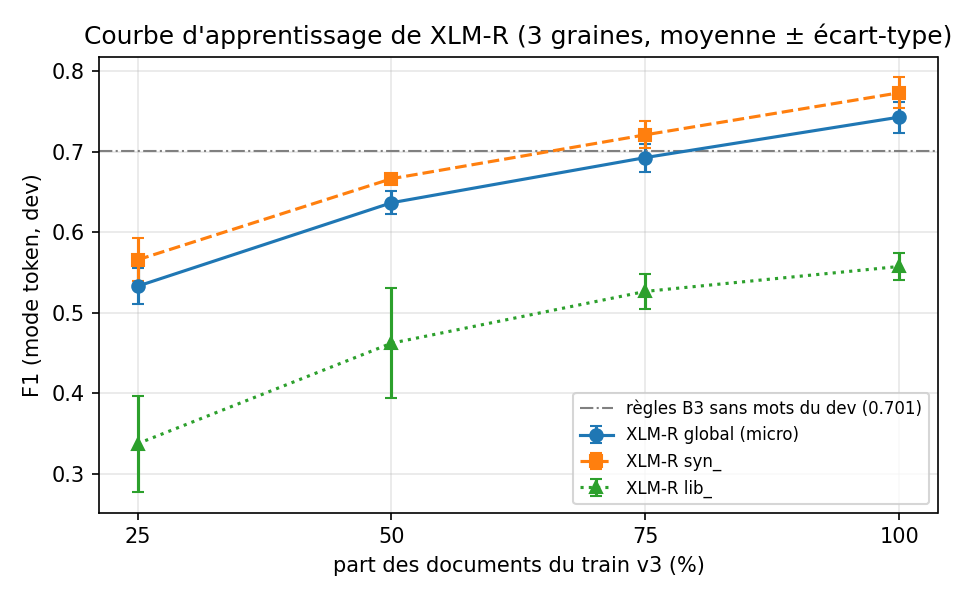

# Lot C · Gold : courbe d'apprentissage de XLM-R (dev)

`xlm-roberta-base`, fine-tuning complet (mêmes réglages qu'au Silver : 10 époques, lr 3e-5, point de contrôle choisi sur le dev), sur 25, 50, 75 et 100 % des **documents** du train v3, tirés par groupe (source × langue, au moins un document par groupe) ; pour une graine, les sous-ensembles sont emboîtés. Graines 13, 42, 2026. Harnais officiel `ner_metrics.py`, mode token, dev (162 passages, 21 documents). Le test gelé n'est pas lu.

## 1. Global, par langue et par source (moyenne ± écart-type, 3 graines)

| Train | F1 micro | macro (9) | fr | ar | en | syn_ | lib_ |
|---|---|---|---|---|---|---|---|
| 25 % | **0.533 ± 0.023** | 0.535 | 0.554 | 0.513 | 0.532 | 0.566 | 0.337 |
| 50 % | **0.637 ± 0.014** | 0.643 | 0.668 | 0.602 | 0.640 | 0.667 | 0.462 |
| 75 % | **0.693 ± 0.017** | 0.702 | 0.713 | 0.662 | 0.701 | 0.721 | 0.526 |
| 100 % | **0.743 ± 0.019** | 0.751 | 0.769 | 0.710 | 0.749 | 0.773 | 0.557 |

Référence : règles B3 sans les mots du dev, F1 micro 0.701.

## 2. Par étiquette (F1 moyenne sur 3 graines)

| Étiquette | 25 % | 50 % | 75 % | 100 % | Écart 75 → 100 % |
|---|---|---|---|---|---|
| ORG | 0.756 | 0.822 | 0.833 | 0.888 | +0.055 |
| PERSONNE | 0.918 | 0.966 | 0.959 | 0.957 | -0.002 |
| SITE | 0.656 | 0.661 | 0.717 | 0.782 | +0.065 |
| DONNEE_SENSIBLE | 0.439 | 0.510 | 0.519 | 0.555 | +0.036 |
| PRODUIT | 0.639 | 0.879 | 0.882 | 0.921 | +0.038 |
| EQUIPEMENT | 0.459 | 0.669 | 0.701 | 0.743 | +0.041 |
| PROCESSUS | 0.199 | 0.381 | 0.443 | 0.526 | +0.083 |
| INDICATEUR | 0.336 | 0.383 | 0.417 | 0.423 | +0.006 |
| CONTRAINTE | 0.416 | 0.516 | 0.847 | 0.961 | +0.114 |

## 3. Bootstrap apparié entre fractions voisines (même graine, par document, 1 000 tirages)

Écart = F1(fraction haute) − F1(fraction basse) ; p bilatérale ; conclusion tirée de l'IC 95 %.

| Comparaison | Graine | Moyenne | Écart | IC 95 % | p bilatérale | Conclusion |
|---|---|---|---|---|---|---|
| 50 % vs 25 % | 13 | micro | +0.085 | [+0.046 ; +0.128] | 0.0020 | gain |
| 50 % vs 25 % | 13 | macro_9 | +0.085 | [+0.051 ; +0.127] | 0.0020 | gain |
| 50 % vs 25 % | 42 | micro | +0.151 | [+0.118 ; +0.187] | 0.0020 | gain |
| 50 % vs 25 % | 42 | macro_9 | +0.160 | [+0.124 ; +0.199] | 0.0020 | gain |
| 50 % vs 25 % | 2026 | micro | +0.075 | [+0.039 ; +0.115] | 0.0020 | gain |
| 50 % vs 25 % | 2026 | macro_9 | +0.078 | [+0.042 ; +0.118] | 0.0020 | gain |
| 75 % vs 50 % | 13 | micro | +0.070 | [+0.030 ; +0.113] | 0.0020 | gain |
| 75 % vs 50 % | 13 | macro_9 | +0.075 | [+0.040 ; +0.115] | 0.0020 | gain |
| 75 % vs 50 % | 42 | micro | +0.048 | [+0.021 ; +0.075] | 0.0020 | gain |
| 75 % vs 50 % | 42 | macro_9 | +0.050 | [+0.024 ; +0.078] | 0.0040 | gain |
| 75 % vs 50 % | 2026 | micro | +0.051 | [+0.020 ; +0.081] | 0.0020 | gain |
| 75 % vs 50 % | 2026 | macro_9 | +0.052 | [+0.023 ; +0.078] | 0.0020 | gain |
| 100 % vs 75 % | 13 | micro | +0.007 | [-0.023 ; +0.037] | 0.6354 | pas de différence démontrée |
| 100 % vs 75 % | 13 | macro_9 | +0.007 | [-0.021 ; +0.035] | 0.5914 | pas de différence démontrée |
| 100 % vs 75 % | 42 | micro | +0.057 | [+0.023 ; +0.093] | 0.0020 | gain |
| 100 % vs 75 % | 42 | macro_9 | +0.057 | [+0.021 ; +0.097] | 0.0020 | gain |
| 100 % vs 75 % | 2026 | micro | +0.087 | [+0.057 ; +0.122] | 0.0020 | gain |
| 100 % vs 75 % | 2026 | macro_9 | +0.081 | [+0.051 ; +0.118] | 0.0020 | gain |

## 4. Lecture

- F1 micro : 0.533 → 0.637 → 0.693 → 0.743 (25 → 100 %). Dernier palier (75 → 100 %) : +0.050 en moyenne ; gain démontré (IC 95 % au-dessus de 0, micro) pour 2 graine(s) sur 3.
- **La courbe monte encore à 100 %** : XLM-R n'est pas saturé, ajouter des données devrait encore payer (contrairement au CRF, qui plafonne dès 50 % du train : 0,378 puis 0,393).
- Étiquettes qui progressent encore (75 → 100 %, ≥ +0,03) : CONTRAINTE +0.114, PROCESSUS +0.083, SITE +0.065, ORG +0.055, EQUIPEMENT +0.041, PRODUIT +0.038, DONNEE_SENSIBLE +0.036. Étiquettes à plat (< +0,01) : PERSONNE -0.002, INDICATEUR +0.006 : pour elles, plus de données du même type ne suffira pas (cibler leur diversité ou leurs bornes).
- Textes libres (lib_) : 0.526 → 0.557 ; synthétiques (syn_) : 0.721 → 0.773.
- XLM-R ne dépasse les règles B3 (0.701) qu'à partir de 100 % du train.
- Limites : dev de 21 documents (IC larges) ; points de contrôle choisis sur le dev (optimiste pour toutes les fractions de la même façon) ; une seule série de sous-ensembles par graine.
