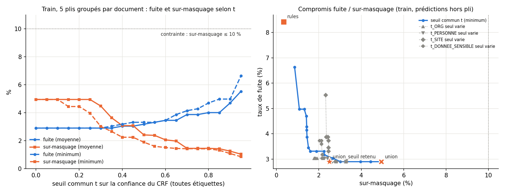

# Lot B · B6 — Anonymisation des documents (dev)

Auteur : Ali (Lot B). Date : 26/10/2026, mis à jour le 27/10/2026 (B6b : backend `union_seuil`, extension des
montants, annexe SITE ; B6d : sur-masquage de `union_seuil`, section 4 ter ; B6e : plis par gabarit, section 4 quater). Split évalué : **dev** (`data/final/documents_dev.jsonl`, 21 documents, 171 passages, 213
occurrences sensibles gold). Le test gelé n'a pas été lu. Les 20 fuites analysées et le choix des seuils de B6b
viennent du **train**.

Commandes : `python -m scripts.b6b_union_seuil_cv` (train seul, ≈ 3 min avec les règles en cache, ≈ 7 min sans), puis
`python -m scripts.eval_anonymization` (dev, ≈ 5 min), lancé **une seule fois** après avoir figé les seuils. Tous les
chiffres sont dans `results/lotb/b6_anonymisation_dev.json` et `results/lotb/b6b_union_seuil_cv.json`, et les
tableaux complets (détail par backend, totales et partielles par tranche) dans `results/lotb/b6_anonymisation_dev.md`.

## 1. Ce qui a été construit

| Module | Rôle |
|---|---|
| `caseforge/anonymization/detect.py` | Détection des mentions ORG, PERSONNE, SITE et DONNEE_SENSIBLE. Cinq backends : `gold` (borne haute) ; `rules` (B3 pour ORG / PERSONNE / SITE, **B1 ∪ B3** pour DONNEE_SENSIBLE) ; `b3` (B3 seul, pour comparer) ; `crf` (CRF B1, qui reproduit à l'identique `b1_crf_dev.jsonl`, 0 passage sur 162 ne diffère) ; `union` (`rules` ∪ `crf`) ; `union_seuil` (B6b : `rules` ∪ entités du CRF assez sûres, section 4 bis). Les spans qui se chevauchent sont fusionnés et prennent l'étiquette la plus prioritaire. Extension des montants (`etendre_montants`, B6b). |
| `caseforge/anonymization/coref_simple.py` | Coréférence minimale (en attendant B5) : même forme normalisée (casse, accents, diacritiques, alif, proclitique, civilité, mots génériques de SITE, bruit OCR à une édition près), sigle défini entre parenthèses ou sigle dont les deux premières lettres sont les initiales de l'ORG, nom de famille seul, initiale + nom. |
| `caseforge/anonymization/policy.py` + `configs/anonymization.yaml` | Pseudonymes et masques typés (section 2). |
| `caseforge/anonymization/anonymizer.py` | `anonymize_document(doc, backend)` → `{passages: [{text, text_anonymise, masque_offsets}], remplacements, journal}`. Un cluster reçoit un seul pseudonyme dans tout le document. Le remplacement se fait de droite à gauche. Un second passage, le **balayage**, cherche dans tout le document les formes déjà remplacées ailleurs (forme exacte, forme sans proclitique, sigle). |
| `scripts/eval_anonymization.py` | Évaluation : 6 backends × (avec et sans coréférence) × (avec et sans balayage), et sans extension des montants pour la configuration par défaut. |
| `scripts/b6b_union_seuil_cv.py` | B6b : choix des seuils de `union_seuil` par validation croisée sur le train, figure `reports/figures/b6b_fuite_surmasquage_train.png`. |
| `tests/test_anonymisation.py` | 28 tests : cohérence des pseudonymes, offsets après remplacement, arabe avec proclitique, balayage, sigles, MUC / B³, confiance et filtre de `union_seuil`, extension des montants. |

## 2. Format des pseudonymes (relevé dans `documents_*.jsonl`)

Inspection des `remplacements` du train (724 occurrences sensibles) :

| Étiquette | Remplacement du Lot A | Effectifs du train |
|---|---|---|
| ORG | `[ENTREPRISE_A]`, `[ENTREPRISE_B]`… (lettres) | 188 + 1 |
| PERSONNE | `[PERSONNE_1]`, `[PERSONNE_2]`… (chiffres) | 153 + 2 + 1 |
| SITE | `[SITE_1]`… (chiffres) | 175 |
| DONNEE_SENSIBLE | `[DONNEE_MASQUEE]` (masque unique) | 204 |

- Le rang est celui du cluster (`ref`) dans le document, par ordre de première apparition. Sur le train, aucun cluster ne reçoit deux pseudonymes (406 clusters).
- Le proclitique arabe reste hors du pseudonyme (« ب[SITE_1] ») et le mot générique hors du span reste visible (« the [SITE_1] site »).

Notre politique garde exactement ce format pour ORG, PERSONNE et SITE. Pour DONNEE_SENSIBLE, comme demandé, elle s'en écarte en typant le masque : `[MONTANT]`, `[CONTRAT]`, `[EMAIL]`, `[TELEPHONE]` ou `[REFERENCE]` selon le sous-type du diagnostic B3. Pour mesurer l'accord avec la référence, les masques typés sont ramenés à `[DONNEE_MASQUEE]`.

## 3. Correction unique de B3 : téléphone et montants en toutes lettres

Correction faite une seule fois (`caseforge/extraction/rules/regex.py`, `data/lexicons/donnees_sensibles.txt`), à partir du plan de numérotation tunisien, du guide v2 et du train, sans lire le dev.

- **Téléphone** : 8 chiffres, le premier entre 2 et 9, groupés 2-3-3, 2-2-2-2 ou collés ; séparateur espace (insécable comprise), point ou tiret ; indicatif `+216`, `00216` ou `(+216)` facultatif ; chiffres arabes admis. On rejette seulement un nombre suivi d'une devise, d'un multiplicateur, d'une unité ou de « % », ou précédé d'une devise. L'ancienne règle rejetait aussi tout numéro suivi d'une lettre minuscule.
- **Montants en lettres** : « 4,3 millions de dinars », « deux millions d'euros », « million TND », « مليون دينار », « ثلاثة ملايين دينار تونسي ». Le filtre du plafond de contrainte (cas 5) s'applique toujours.

Rappel DONNEE_SENSIBLE de B3, mode token (caractère entre parenthèses) :

| Split · tranche | Avant | Après |
|---|---|---|
| train · global | 0,882 (0,831) | 0,882 (0,831), aucune prédiction changée |
| dev · global | 0,594 (0,675) | **0,734** (0,762) |
| dev · téléphone (14) | 0,357 | **1,000** |
| dev · montant (15) | 0,267 (0,656) | 0,267 (0,656) |
| dev · fr / ar / en | 0,458 / 0,650 / 0,700 | 0,667 / 0,650 / 0,900 |

La précision token de B3 sur DONNEE_SENSIBLE passe de 0,776 à 0,810. Sur l'ensemble du dev, B3 passe de 0,664 à 0,678 (micro token) et de 0,649 à 0,660 (macro). B1 ∪ B3 reste à 0,906 de rappel.

Les montants du dev ne sont pas mieux trouvés : ce n'était pas une forme en lettres, mais une bordure (le span gold inclut le nom du montant, B3 ne masque que la valeur, d'où un rappel caractère de 0,656). Le backend `rules` les couvre par B1.

## 4. Tableau principal (dev, coréférence + balayage + extension des montants)

| Backend | Taux de fuite [IC 95 %] | Totales / partielles | Sur-masquage | F1 caractère (sensibles) | Cohérence | Accord réf. (sans n°) |
|---|---|---|---|---|---|---|
| gold (borne haute) | 0,0 % | 0 / 0 | 0,0 % | 1,000 | 100,0 % | 100,0 % |
| **rules** | **12,2 %** [7,4 ; 18,0] | 17 / 9 | **7,0 %** | **0,847** | 88,1 % | 77,2 % |
| b3 seul (comparaison) | 17,4 % [12,2 ; 23,1] | 17 / 20 | 2,8 % | 0,822 | 88,1 % | 78,4 % |
| crf | 28,2 % [20,7 ; 36,1] | 50 / 10 | 29,7 % | 0,458 | 100,0 % | 50,9 % |
| union | **7,5 %** [3,7 ; 12,3] | 11 / 5 | 29,7 % | 0,564 | 80,6 % | 55,6 % |
| **union_seuil** (B6b) | **7,5 %** [3,7 ; 12,3] | 11 / 5 | 24,8 % | 0,598 | 82,3 % | 60,2 % |
| union_seuil (B6c : règles de rappel, balayage renforcé) | 6,6 % [3,2 ; 10,7] | 9 / 5 | 24,5 % | 0,606 | non mesuré | non mesuré |
| **union_seuil (B6d, recommandé : B6c + plafonds de budget)** | **6,6 %** [3,2 ; 10,7] | 9 / 5 | **21,9 %** | **0,628** | non mesuré | non mesuré |
| union_seuil (B6d + fusion aux bornes des règles, *désactivée*) | 9,4 % [6,0 ; 13,5] | 10 / 10 | 3,0 % | 0,885 | non mesuré | non mesuré |

- IC 95 % : bootstrap par document, 1 000 tirages, graine 42.
- Cohérence : part des clusters gold dont les mentions masquées ont toutes le même pseudonyme. Pureté (un cluster gold par pseudonyme) : 100 % pour `gold`, `rules`, `b3` et `union_seuil`, 98,1 % pour `crf`, 98,6 % pour `union`.
- Accord : passages identiques au `text_anonymise` de référence, sans tenir compte de la numérotation ; en comptant la numérotation, 73,1 % pour `rules`, 50,3 % pour `union`, 53,8 % pour `union_seuil`.
- L'extension des montants ne change aucun chiffre de ce tableau (section 4 bis) : les lignes `gold` à `union` sont identiques à celles du 26/10.
- Les trois dernières lignes (B6c, B6d) viennent de `results/lotb/b6c_dev.json` et `results/lotb/b6d_dev.json` ; leurs ventilations sont à la section 4 ter et dans `results/lotb/b6d.md`.

**Comparaisons appariées** (mêmes occurrences, bootstrap apparié par document, 10 000 tirages) :

| Comparaison | Écart de fuite | IC 95 % |
|---|---|---|
| `rules` − `union` | +4,7 points | [+2,3 ; +7,4] |
| `b3` − `rules` | +5,2 points | [+3,2 ; +7,0] |
| `crf` − `union` | +20,7 points | [+14,4 ; +27,6] |
| `rules` − `union_seuil` | +4,7 points | [+2,3 ; +7,4] |
| `union_seuil` − `union` | 0,0 point | [0,0 ; 0,0] |

Les quatre premiers écarts sont significatifs. B1 ∪ B3 améliore bien `rules` par rapport à B3 seul, et `union` comme `union_seuil` fuient moins que `rules`. `union_seuil` et `union` laissent fuir exactement les mêmes 16 occurrences du dev : les entités du CRF écartées par le seuil ne couvraient aucune occurrence sensible qui n'était pas déjà masquée.

## 4 bis. B6b · Compromis fuite / sur-masquage

### Backend `union_seuil` : seuils choisis sur le train

**Principe.** `union_seuil` = `rules` ∪ entités du CRF dont la confiance atteint un seuil t propre à leur étiquette. La confiance d'une entité vient de `predict_marginals` (sklearn-crfsuite). Pour chaque token, on calcule P(B-X) + P(I-X), la probabilité que le token appartienne à l'étiquette X, quelle que soit sa position. On n'utilise pas la seule probabilité du tag prédit, parce qu'une hésitation entre B et I ne change rien au masque. Cette probabilité est ensuite agrégée sur les tokens de l'entité, par la **moyenne** ou par le **minimum**.

**Protocole** (`scripts/b6b_union_seuil_cv.py`, train seulement, le dev n'est pas lu) :

- 5 plis **groupés par document** (66 documents mélangés avec la graine 42, puis répartis à tour de rôle, 13 ou 14 par pli) ;
- pour chaque pli, le CRF B1 est réentraîné sur les 4 autres plis (389 à 397 passages). Les passages dont le texte figure aussi dans le pli tenu à part sont retirés, car 16 titres sont communs à plusieurs documents ;
- l'anonymiseur complet (coréférence, balayage, extension des montants) est appliqué aux prédictions hors pli. Objectif : **fuite minimale sous la contrainte sur-masquage ≤ 10 %** ; à égalité, sur-masquage le plus faible, puis seuils les plus hauts ;
- recherche : un seuil commun t ∈ {0 ; 0,05 ; … ; 0,95} (courbe), puis descente par coordonnées étiquette par étiquette (grille + « aucune entité du CRF »), en partant du meilleur seuil commun.

**Résultat de la validation croisée** (train, 724 occurrences) :

| Agrégation | Seuils ORG / PERSONNE / SITE / DONNEE_SENSIBLE | Fuite | Sur-masquage |
|---|---|---|---|
| (rules) | — | 8,4 % [6,4 ; 10,8] | 0,3 % |
| (union, t = 0) | 0 / 0 / 0 / 0 | 2,9 % | 4,9 % |
| moyenne | 0,35 / 0,85 / 0,55 / 0,35 | 2,9 % | 3,3 % |
| **minimum (retenu)** | **0,35 / 0,80 / 0,55 / 0,30** | **2,9 %** [1,2 ; 4,9] | **2,5 %** |

- **Choix de l'agrégation.** Les deux agrégations donnent la même fuite. Le minimum la donne avec moins de sur-masquage : une entité vaut ce que vaut son token le moins sûr. C'est le critère le plus prudent contre les spans du CRF trop longs, qui débordent sur un équipement ou un mot voisin (le défaut de `union` au dev). La moyenne laisse passer une entité longue dont seuls quelques tokens sont sûrs. Le choix suit la règle fixée d'avance (à fuite égale, sur-masquage le plus faible).
- **Ventilations du point retenu (train, CV)** :
  - fuite par étiquette : ORG 0,5 %, PERSONNE 0,0 %, SITE 1,1 %, DONNEE_SENSIBLE 8,8 % ;
  - par langue : ar 3,0 %, en 2,4 %, fr 3,3 % ;
  - par source : syn_ 0,0 %, lib_ 28,4 % ;
  - sur-masquage : ar 3,1 %, en 1,2 %, fr 3,1 %, syn_ 0,9 %, lib_ 15,8 % ;
  - passages mixtes : 71 occurrences, 2 fuites.
- **Figure** : `reports/figures/b6b_fuite_surmasquage_train.png`. À gauche, fuite et sur-masquage selon le seuil commun t, pour les deux agrégations. À droite, le compromis fuite / sur-masquage, avec les courbes « une seule étiquette varie » autour du point retenu.

**Évaluation unique sur le dev** (section 4) : fuite **7,5 %** [3,7 ; 12,3], identique à `union` ; sur-masquage **24,8 %** au lieu de 29,7 %. Les caractères sur-masqués hors entité (O) passent de 785 à 630, et ceux d'EQUIPEMENT de 66 à 0. Ventilations du dev pour `union_seuil` :

| Tranche | Fuite [IC 95 %] | Sur-masquage | F1 caractère |
|---|---|---|---|
| ORG (40) | 10,0 % [2,4 ; 20,0] | — | 0,608 |
| PERSONNE (52) | 3,8 % [0,0 ; 9,6] | — | 0,939 |
| SITE (57) | 8,8 % [1,9 ; 15,8] | — | 0,842 |
| DONNEE_SENSIBLE (64) | 7,8 % [0,0 ; 16,7] | — | 0,053 |
| ar (69) | 7,2 % [2,7 ; 13,4] | 23,5 % | 0,523 |
| en (70) | 10,0 % [2,5 ; 22,4] | 23,3 % | 0,638 |
| fr (74) | 5,4 % [1,2 ; 12,9] | 27,3 % | 0,628 |
| syn_ (192) | 4,2 % [2,0 ; 6,3] | 25,9 % | 0,591 |
| lib_ (21) | 38,1 % [28,6 ; 50,0] | 10,1 % | 0,667 |

Passages mixtes (annexe) : 5 occurrences, 0 fuite (pas de conclusion, n < 30).

**Résultat négatif : la contrainte des 10 % ne se transfère pas au dev.** Sur le train, en CV, même `union` sans seuil reste sous 10 % de sur-masquage (4,9 %) : la contrainte n'a jamais été active, et c'est la règle d'égalité qui a fixé les seuils. Au dev, le sur-masquage du CRF est six fois plus élevé (29,7 % contre 4,9 %). Explication probable : les documents `syn_` du train partagent des gabarits d'un document à l'autre. La CV groupée par document ne les sépare pas, donc le CRF hors pli reconnaît encore les gabarits : `syn_` fuit 0,0 % en CV, contre 4,2 % au dev. Le seuil choisi est donc trop permissif pour le dev. Conformément au protocole, il n'a **pas** été réajusté sur le dev. Piste pour la suite : des plis groupés par gabarit de génération (information du Lot A), ou une contrainte plus stricte sur le train.

### Extension de bordure des montants

**Règle** (`caseforge.anonymization.detect.etendre_montants`, option `extension_montants` de `configs/anonymization.yaml`, active par défaut, sauf pour `gold`) : une DONNEE_SENSIBLE détectée qui partage au moins un caractère avec un nombre est étendue au nombre complet (séparateurs de milliers, espace insécable comprise, décimales) et au montant qui le contient : multiplicateur, devise ou unité monétaire adjacente (DT, TND, MDT, dinars, دينار, مليون دينار, €, $, HT / TTC). La règle réutilise le motif « montant » de B3 et le lexique `donnees_sensibles`, tirés du guide v2 (cas 5) et du train. Elle a été construite sans lire le dev.

**Rappel des montants** (DONNEE_SENSIBLE gold de sous-type « montant ») :

- *entières* : occurrences entièrement masquées ;
- *caractère* : caractères non blancs masqués ;
- *noyau* : nombre + devise entièrement masqués, même si la description autour reste visible.

| Split · backend (n montants) | Entières avant → après | Caractère avant → après | Noyau avant → après |
|---|---|---|---|
| train CV · rules (47) | 87,2 → 87,2 % | 84,3 → 84,3 % | 100 → 100 % |
| train CV · union_seuil (47) | 91,5 → 91,5 % | 88,5 → 88,5 % | 100 → 100 % |
| dev · rules (15) | 100 → 100 % | 100 → 100 % | 100 → 100 % |
| dev · b3 seul (15) | 26,7 → 26,7 % | 65,6 → 65,6 % | 100 → 100 % |
| dev · crf (15) | 66,7 → 66,7 % | 85,6 → 85,6 % | 100 → 100 % |
| dev · union / union_seuil (15) | 100 → 100 % | 100 → 100 % | 100 → 100 % |

Par langue au dev (`union_seuil`, après extension) : ar 5, en 4, fr 6 montants, tous entièrement masqués ; source : 15 montants, tous `syn_`. Il n'y a aucun montant `lib_` au dev.

**Résultat négatif : l'extension ne change rien sur nos données.** Sur le train, elle ne modifie aucun des 189 spans DONNEE_SENSIBLE de `rules`, et aucun chiffre du dev ne bouge. Le noyau nombre + devise était déjà masqué à 100 % partout. Les règles B1 / B3 prennent le montant entier. La tokenisation `cfdata` du CRF garde « 210,000 » ou « 0,145 » en un seul token ; elle coupe « 12 000 » en deux tokens, mais le CRF n'a coupé aucun montant de ce type au dev (noyau à 100 %). Les montants qui fuient encore (`b3` seul au dev, 6 cas sur 47 au train) fuient par la **description** comprise dans le span gold (« recall cost (…) », « رقم المعاملات … ») : c'est un problème de bordure du gold, pas du nombre. L'extension reste active comme filet de sécurité, pour des montants coupés par un autre détecteur (Lot C), sans coût mesuré : le sur-masquage est inchangé.

**Fuites partielles réduites à des mots génériques.** Pour `rules`, les 9 fuites partielles sont toutes des SITE dont seuls l'article ou le mot générique restent visibles (« the ▮▮▮ site », « la ▮▮▮ »). C'est le cas pour 4 des 5 fuites partielles d'`union`. Le span gold inclut ces mots, contrairement au guide v2 : c'est l'issue #7 du Lot A. Elles restent des fuites pour la métrique officielle. Si on les retire, le taux de fuite identifiante est de 8,0 % (17 / 213) pour `rules` et de 5,6 % (12 / 213) pour `union`.

**Sur-masquage selon l'étiquette gold recouverte** (caractères non blancs) :

| Backend | Caractères sur-masqués |
|---|---|
| `rules` | 205 : CONTRAINTE 118 (montants plafonds masqués par B1), O 65 |
| `crf` | 1 038 : O 753, EQUIPEMENT 66, PROCESSUS 8, PRODUIT 7 |
| `union` | 1 207 : cumul des deux |

## 4 ter. B6d · Sur-masquage de `union_seuil` : fusion des spans et plafonds de budget

**Point de départ** (B6c, dev) : 752 caractères sur-masqués. 616 viennent de spans des règles élargis par leur fusion avec le CRF (`b1+b3+crf` 437, `b3+crf` 166, `crf` 13) ; 114 viennent de B1 seul, qui masque les montants plafonds d'une CONTRAINTE.

**Deux corrections** (`caseforge/anonymization/detect.py`), chacune avec son interrupteur dans `configs/anonymization.yaml` :

- `fusion_crf: regles` (`fusionner_regles`) : quand une entité du CRF chevauche une détection des règles, on garde les bornes des règles au lieu de l'union. Si les étiquettes diffèrent, la plus prioritaire (`caseforge.labels`) s'applique, sans élargir le span. Le CRF n'ajoute que les entités qu'aucune règle n'a trouvées ;
- `plafonds_contrainte` (`retirer_plafonds`, guide v2, cas 5) : une DONNEE_SENSIBLE de sous-type « montant », entièrement contenue dans une CONTRAINTE détectée par B3, n'est pas masquée. B3 le faisait déjà pour ses propres montants ; la correction l'étend à B1 et au CRF.

**Protocole.** Plan 2 × 2 (avant = B6c, chaque correction seule, les deux). Train : 5 plis groupés par document, CRF hors pli (`scripts/b6d_cv.py`, `results/lotb/b6d_cv.json`). Dev : une seule mesure (`scripts/b6d_eval_dev.py`, `results/lotb/b6d_dev.json`, tableaux complets dans `results/lotb/b6d.md`). Règle fixée d'avance : une correction qui augmente la fuite de plus de 1 point est désactivée, sans réajustement.

| Split · variante | Fuite [IC 95 %] | Totales / partielles | Sur-masquage | F1 caractère | Fuite hors mots génériques (diag.) |
|---|---|---|---|---|---|
| train CV · avant (B6c) | 2,9 % [1,2 ; 4,9] | 15 / 6 | 2,5 % | 0,861 | 2,6 % |
| train CV · + fusion aux bornes des règles | 7,5 % [5,5 ; 9,6] | 15 / 39 | 1,2 % | 0,919 | 3,0 % |
| train CV · + plafonds | 2,9 % [1,2 ; 4,9] | 15 / 6 | 2,4 % | 0,862 | 2,6 % |
| train CV · les deux | 7,5 % [5,5 ; 9,6] | 15 / 39 | 1,1 % | 0,919 | 3,0 % |
| **dev · avant (B6c)** | 6,6 % [3,2 ; 10,7] | 9 / 5 | 24,5 % | 0,606 | 4,7 % |
| dev · + fusion aux bornes des règles | 9,4 % [6,0 ; 13,5] | 10 / 10 | 7,1 % | 0,856 | 5,2 % |
| **dev · + plafonds (retenu)** | **6,6 %** [3,2 ; 10,7] | 9 / 5 | **21,9 %** | **0,628** | 4,7 % |
| dev · les deux | 9,4 % [6,0 ; 13,5] | 10 / 10 | 3,0 % | 0,885 | 5,2 % |

**Effet séparé de chaque correction** (Δ fuite / Δ sur-masquage, correction seule) :

- **fusion aux bornes des règles** : train +4,6 / −1,3 points ; dev +2,8 / −17,5 points. **Désactivée** dès le train (`fusion_crf: union`). Le dev confirme la décision, sans réajustement. Les fuites ajoutées sont presque toutes partielles : 30 SITE au train et 5 SITE + 1 PERSONNE au dev. Le CRF couvrait l'article ou le mot générique que le span gold inclut et que les règles laissent de côté (issue #7 du Lot A). Hors mots génériques, le coût n'est plus que de +0,4 point au train et +0,5 point au dev. Elle reste une fuite pour la métrique officielle ;
- **plafonds de budget** : train 0,0 / −0,1 point ; dev 0,0 / −2,6 points. **Gardée** (`plafonds_contrainte: true`). Au dev, les 114 caractères CONTRAINTE sur-masqués disparaissent (752 → 638 caractères), sans aucune fuite DONNEE_SENSIBLE ajoutée.

**Ventilations au dev, avant → retenu** (fuite ; sur-masquage ; F1 caractère) :

| Tranche (n) | Fuite | Sur-masquage | F1 caractère |
|---|---|---|---|
| ORG (40) | 7,5 → 7,5 % | — | 0,633 → 0,633 |
| PERSONNE (52) | 1,9 → 1,9 % | — | 0,949 → 0,949 |
| SITE (57) | 8,8 → 8,8 % | — | 0,842 → 0,842 |
| DONNEE_SENSIBLE (64) | 7,8 → 7,8 % | — | 0,053 → 0,060 |
| ar (69) | 5,8 → 5,8 % | 23,3 → 20,7 % | 0,534 → 0,551 |
| en (70) | 8,6 → 8,6 % | 22,7 → 18,8 % | 0,652 → 0,682 |
| fr (74) | 5,4 → 5,4 % | 27,3 → 25,6 % | 0,628 → 0,647 |
| syn_ (192) | 3,6 → 3,6 % | 25,7 → 22,9 % | 0,596 → 0,620 |
| lib_ (21) | 33,3 → 33,3 % | 9,5 → 9,5 % | 0,703 → 0,703 |

Passages mixtes (annexe) : 5 occurrences, 0 fuite avant et après (pas de conclusion, n < 30). Les IC par tranche sont dans `results/lotb/b6d.md`.

**Résultat négatif.** Le sur-masquage du dev reste à 21,9 %. Il vient pour l'essentiel (603 caractères sur 638) de spans des règles élargis par le CRF. Les supprimer coûte des fuites partielles de bordure tant que les spans gold SITE incluent l'article ou le mot générique. Export de la variante retenue pour le Lot D : `results/lotb/b6d_anonymisation_dev_union_seuil.jsonl`.

## 4 quater. B6e · Seuils de `union_seuil` rechoisis avec des plis groupés par gabarit (résultat négatif)

**Hypothèse testée** (section 4 bis) : au B6b, les plis groupés par document laissaient le même gabarit des deux côtés, d'où un sur-masquage du train (2,5 %) très inférieur à celui du dev (21,9 % au B6d), et une contrainte des 10 % jamais active.

**Protocole** (`scripts/b6e_plis_gabarit_cv.py`, train seul, le dev n'est pas lu) :

- plis `caseforge.eval.plis_gabarit.plis_gabarit` : les 54 documents `syn_` sont groupés par `format`, avec un format par pli (cahier_charges 9, demande_pfe 9, email 10, fiche_nc 13, pv_reunion 13). Les 12 documents `lib_` sont mélangés avec la graine 42, puis répartis à tour de rôle (3, 3, 2, 2, 2). Le CRF est réentraîné par pli (384 à 411 passages) ;
- options B6d de `configs/anonymization.yaml` inchangées (`fusion_crf: union`, `plafonds_contrainte: true`, règles de rappel B6c), anonymiseur complet ;
- recherche et règle de B6b, fixées avant le lancement : fuite minimale sous sur-masquage ≤ 10 % (taux poolé), puis sur-masquage minimal, puis seuils les plus hauts ;
- règle fixée avant le dev (`decision_seuils`) : les nouveaux seuils remplacent ceux du YAML si, au dev, la fuite ne monte pas de plus de 1 point et le sur-masquage baisse. Une seule mesure (`scripts/b6e_eval_dev.py`), sans réajustement.

**Train, CV par gabarit** (724 occurrences ; tableaux complets dans `results/lotb/b6e.md`) :

| Point | Seuils ORG / PERSONNE / SITE / DONNEE_SENSIBLE | Fuite [IC 95 %] | Sur-masquage | F1 caractère |
|---|---|---|---|---|
| rules | — | 8,3 % [6,2 ; 10,7] | 0,2 % | 0,927 |
| union (t = 0) | 0 / 0 / 0 / 0 | 3,5 % [1,6 ; 5,8] | 3,7 % | 0,853 |
| seuils B6b (YAML) | minimum 0,35 / 0,80 / 0,55 / 0,30 | 3,5 % [1,6 ; 5,8] | 2,2 % | 0,868 |
| **B6e** | **moyenne 0,35 / aucune entité / 0,70 / 0,35** | 3,5 % [1,6 ; 5,8] | 1,8 % | 0,907 |

- Les deux agrégations donnent le même point (3,5 % / 1,8 %). La moyenne est retenue, car ses seuils sont les plus hauts (SITE 0,70 contre 0,65).
- Par pli, `union` sans seuil reste entre 1,2 et 5,3 % de sur-masquage. **Le format tenu à part ne reproduit pas l'écart avec le dev** : la contrainte des 10 % n'est toujours pas active, et c'est encore la règle d'égalité qui fixe les seuils.
- Ventilations (B6b → B6e) : la fuite ne change dans aucune tranche (ORG 0,5 %, PERSONNE 0,0 %, SITE 1,1 %, DONNEE_SENSIBLE 10,8 % ; ar 4,3 %, en 2,8 %, fr 3,3 % ; syn_ 0,0 %, lib_ 33,8 %). Sur-masquage : ar 2,2 → 1,5 %, en 1,4 → 1,2 %, fr 3,1 → 2,7 %, syn_ 0,9 → 0,6 %, lib_ 14,8 → 13,3 %. Passages mixtes : 71 occurrences, 2 fuites dans les deux cas.

**Dev, mesure unique** :

| Seuils | Fuite [IC 95 %] | Totales / partielles | Sur-masquage | F1 caractère | Fuites de noms |
|---|---|---|---|---|---|
| **B6b (YAML, retenus)** | **6,6 %** [3,2 ; 10,7] | 9 / 5 | **21,9 %** | **0,628** | 4 |
| B6e | 8,5 % [4,6 ; 12,9] | 10 / 8 | 24,6 % | 0,605 | 4 |

| Tranche (n) | Fuite B6b → B6e | Sur-masquage B6b → B6e | F1 caractère B6b → B6e |
|---|---|---|---|
| ORG (40) | 7,5 → 7,5 % | — | 0,633 → 0,608 |
| PERSONNE (52) | 1,9 → 1,9 % | — | 0,949 → 0,929 |
| SITE (57) | 8,8 → 15,8 % | — | 0,842 → 0,804 |
| DONNEE_SENSIBLE (64) | 7,8 → 7,8 % | — | 0,060 → 0,060 |
| ar (69) | 5,8 → 7,2 % | 20,7 → 24,6 % | 0,551 → 0,560 |
| en (70) | 8,6 → 8,6 % | 18,8 → 23,3 % | 0,682 → 0,652 |
| fr (74) | 5,4 → 9,5 % | 25,6 → 25,8 % | 0,647 → 0,602 |
| syn_ (192) | 3,6 → 5,2 % | 22,9 → 25,0 % | 0,620 → 0,599 |
| lib_ (21) | 33,3 → 38,1 % | 9,5 → 19,7 % | 0,703 → 0,667 |

Passages mixtes (annexe) : 5 occurrences, 0 fuite dans les deux cas (pas de conclusion, n < 30).

**Décision : seuils B6e non retenus** (Δ fuite +1,9 point, Δ sur-masquage +2,7 points). `configs/anonymization.yaml` garde les seuils B6b ; l'objectif de 10 % n'est pas atteint. L'export du dev (`results/lotb/b6e_anonymisation_dev_union_seuil.jsonl`) correspond donc aux seuils B6b, comme celui de B6d.

**Lecture.**

- Sur les 4 SITE de plus qui fuient, 3 sont des fuites partielles (SITE : 0 / 5 → 1 / 8 totales / partielles). Avec un seuil SITE plus haut, le CRF ne couvre plus l'article ou le mot générique compris dans le span gold (issue #7 du Lot A). La quatrième est une fuite totale, que le CRF masquait avec le seuil 0,55 : hors mots génériques, la fuite passe de 4,7 à 5,2 %.
- Le sur-masquage ajouté vient de la moyenne : elle laisse passer des entités longues du CRF dont seuls quelques tokens sont sûrs. Ces entités élargissent les spans des règles (`b3+crf` : 166 → 284 caractères), ce que le minimum de B6b évitait.
- Surtout, aucun réglage de seuil ne peut atteindre 10 % au dev. 437 des 638 caractères sur-masqués viennent de spans `b1+b3+crf`, élargis par des entités du CRF qui chevauchent une règle avec une forte confiance. Le seul levier mesuré qui agit dessus est la fusion aux bornes des règles (section 4 ter, 3,0 % de sur-masquage), désactivée pour son coût en fuite tant que l'issue #7 n'est pas corrigée.
- L'écart entre le train et le dev ne vient donc pas du partage des formats entre plis. Les documents `syn_` du train restent à 0,0 % de fuite, même pour un format jamais vu. Une explication possible, non vérifiée, est que les documents du dev viennent d'autres gabarits ou d'autres valeurs du générateur, dans les mêmes formats. Cette information doit venir du Lot A.

## 5. Ventilations (dev, coréférence + balayage)

### Taux de fuite [IC 95 %]

| Tranche (n) | rules | b3 | crf | union |
|---|---|---|---|---|
| ORG (40) | 12,5 % [2,4 ; 25,7] | 12,5 % [2,4 ; 25,7] | 37,5 % [26,8 ; 47,4] | 10,0 % [2,4 ; 20,0] |
| PERSONNE (52) | 7,7 % [0,0 ; 19,2] | 7,7 % [0,0 ; 19,2] | 17,3 % [7,8 ; 27,8] | 3,8 % [0,0 ; 9,6] |
| SITE (57) | 19,3 % [11,1 ; 27,3] | 19,3 % [11,1 ; 27,3] | 43,9 % [28,1 ; 60,8] | 8,8 % [1,9 ; 15,8] |
| DONNEE_SENSIBLE (64) | 9,4 % [0,0 ; 20,7] | 26,6 % [17,2 ; 37,1] | 17,2 % [7,4 ; 28,8] | 7,8 % [0,0 ; 16,7] |
| ar (69) | 11,6 % [3,1 ; 20,9] | 18,8 % [11,8 ; 27,1] | 47,8 % [43,7 ; 52,4] | 7,2 % [2,7 ; 13,4] |
| en (70) | 10,0 % [2,5 ; 22,4] | 10,0 % [2,5 ; 22,4] | 21,4 % [11,5 ; 37,5] | 10,0 % [2,5 ; 22,4] |
| fr (74) | 14,9 % [8,4 ; 27,0] | 23,0 % [16,9 ; 33,9] | 16,2 % [11,1 ; 24,2] | 5,4 % [1,2 ; 12,9] |
| syn_ (192) | 7,8 % [5,2 ; 10,7] | 13,5 % [9,9 ; 17,7] | 24,5 % [17,5 ; 32,1] | 4,2 % [2,0 ; 6,3] |
| lib_ (21) | 52,4 % [42,9 ; 66,7] | 52,4 % [42,9 ; 66,7] | 61,9 % [50,0 ; 75,0] | 38,1 % [28,6 ; 50,0] |

Passages mixtes (annexe) : 5 occurrences sensibles, 0 fuite pour `rules` et `union`, 2 pour `crf`. Pas de conclusion (n < 30).

Les 6 fuites DONNEE_SENSIBLE de `rules` sont toutes des données décrites sans chiffre (section 8). La source `lib_` (3 documents, 21 occurrences) fuit beaucoup plus que `syn_` : textes libres, noms sans déclencheur, descriptions. L'IC y est large.

### Sur-masquage

| Tranche | rules | b3 | crf | union |
|---|---|---|---|---|
| ar | 8,8 % | 5,1 % | 30,7 % | 28,7 % |
| en | 8,6 % | 3,0 % | 25,4 % | 27,4 % |
| fr | 3,3 % | 0,0 % | 32,1 % | 32,7 % |
| syn_ | 6,7 % | 2,2 % | 30,1 % | 30,6 % |
| lib_ | 11,3 % | 11,3 % | 24,9 % | 19,5 % |

### F1 stricte au caractère, entités sensibles (métrique secondaire)

| Tranche | rules | b3 | crf | union |
|---|---|---|---|---|
| ORG | 0,805 | 0,805 | 0,441 | 0,582 |
| PERSONNE | 0,960 | 0,960 | 0,844 | 0,918 |
| SITE | 0,768 | 0,768 | 0,547 | 0,759 |
| DONNEE_SENSIBLE | 0,853 | 0,770 | 0,040 | 0,052 |
| ar / en / fr | 0,800 / 0,875 / 0,863 | 0,748 / 0,913 / 0,803 | 0,314 / 0,548 / 0,484 | 0,523 / 0,609 / 0,557 |
| syn_ / lib_ | 0,865 / 0,625 | 0,839 / 0,625 | 0,466 / 0,375 | 0,559 / 0,611 |

La F1 DONNEE_SENSIBLE d'`union` s'effondre parce que la fusion des spans du CRF avec ceux des règles élargit les bornes. Le masque couvre l'entité (pas de fuite), mais le span n'est plus exact.

### Cohérence des pseudonymes (clusters gold)

| Tranche (clusters) | rules | b3 | crf | union |
|---|---|---|---|---|
| ORG (21) | 78,9 % | 78,9 % | 100,0 % | 60,0 % |
| PERSONNE (23) | 100,0 % | 100,0 % | 100,0 % | 95,2 % |
| SITE (21) | 84,2 % | 84,2 % | 100,0 % | 85,7 % |
| ar / en / fr (23 / 21 / 21) | 65,0 / 100,0 / 100,0 % | 65,0 / 100,0 / 100,0 % | 100 / 100 / 100 % | 66,7 / 95,0 / 81,0 % |
| syn_ / lib_ (54 / 11) | 86,5 / 100,0 % | 86,5 / 100,0 % | 100,0 / 100,0 % | 78,8 / 90,0 % |

Le CRF est « cohérent » parce qu'il masque peu de mentions par cluster. Avec les règles, l'incohérence vient de spans détectés différents pour une même entité arabe (bordures), qui ne retombent pas sur la même clé.

### Accord avec `text_anonymise` de référence (passages identiques sans numérotation)

| Tranche (passages) | rules | b3 | crf | union |
|---|---|---|---|---|
| ar (56) | 75,0 % | 73,2 % | 44,6 % | 60,7 % |
| en (56) | 78,6 % | 87,5 % | 57,1 % | 57,1 % |
| fr (59) | 78,0 % | 74,6 % | 50,8 % | 49,2 % |
| syn_ (151) | 78,8 % | 80,1 % | 49,7 % | 54,3 % |
| lib_ (20) | 65,0 % | 65,0 % | 60,0 % | 65,0 % |

## 6. Ablations : balayage et coréférence (dev)

Format : fuite / sur-masquage / cohérence.

| Backend | coref + balayage | coref seule | balayage seul | ni l'un ni l'autre |
|---|---|---|---|---|
| gold | 0,0 / 0,0 / 100,0 % | 0,0 / 0,0 / 100,0 % | 0,0 / 0,0 / 35,4 % | 0,0 / 0,0 / 35,4 % |
| rules | 12,2 / 7,0 / 88,1 % | 13,1 / 7,0 / 88,1 % | 12,2 / 7,0 / 35,6 % | 13,1 / 7,0 / 35,6 % |
| b3 | 17,4 / 2,8 / 88,1 % | 18,3 / 2,8 / 88,1 % | 17,4 / 2,8 / 35,6 % | 18,3 / 2,8 / 35,6 % |
| crf | 28,2 / 29,7 / 100,0 % | 36,2 / 30,9 / 100,0 % | 28,2 / 29,7 / 70,4 % | 36,2 / 30,9 / 70,4 % |
| union | 7,5 / 29,7 / 80,6 % | 7,5 / 29,0 / 80,6 % | 7,5 / 29,7 / 32,3 % | 7,5 / 29,0 / 32,3 % |

- **Balayage** : il réduit la fuite de 0,9 point pour les règles (2 mentions ajoutées) et de 8 points pour le CRF (22 mentions ajoutées : le CRF trouve une forme une fois, puis la rate ailleurs). Il n'apporte rien à `union`, qui détecte déjà ces formes. Il ne crée presque pas de sur-masquage.
- **Coréférence** : elle ne change pas la fuite (elle ne masque rien), mais fait passer la cohérence de 35 % à 88 % avec les règles. Sans elle, « Mme Dorra B. », « D. B. » et « B. » reçoivent trois pseudonymes.

**Coréférence seule** (mentions gold, comparée au champ `ref`, 149 mentions) : MUC F1 1,000 et B³ F1 1,000 avec les règles, 0,645 et 0,794 sans. Par étiquette, MUC F1 sans coréférence : ORG 0,417, PERSONNE 0,619, SITE 0,759. Les règles ORG (sigle non défini), OCR et élision (« l'usine ») ont été ajoutées après une première évaluation du dev, où MUC ORG valait 0,538. Elles ont été construites uniquement à partir des 14 clusters scindés du **train**, sans voir de texte du dev. Sur le train, MUC F1 passe de 0,978 à 0,998 (précision 1,000).

## 7. Vingt fuites du TRAIN analysées par cause (`rules`, coréférence + balayage)

Sur le train, `rules` fuit 61 occurrences sur 724 (8,4 %, IC 95 % [6,4 ; 10,8]) : 22 totales et 39 partielles. Par étiquette : ORG 3 / 189, PERSONNE 2 / 156, SITE 32 / 175, DONNEE_SENSIBLE 24 / 204. Ce chiffre est optimiste, puisque les règles ont été conçues sur le train.

Les fuites d'`union` n'ont pas été analysées sur le train : son CRF a appris le train, et il ne laisse aucune fuite.

Causes des 61 fuites :

| Cause | Effectif |
|---|---|
| Bordure : mention détectée, span trop court | 39 |
| DONNEE_SENSIBLE décrite sans chiffre | 14 |
| Entité jamais détectée | 5 |
| Variante non retrouvée (entité masquée ailleurs) | 3 |

Échantillon de 20 (tirage aléatoire, graine 42). ▮ = caractère masqué.

| # | Passage | Étiquette | Après masquage | Cause | Commentaire |
|---|---|---|---|---|---|
| 1 | syn_en_017_p001 | SITE | the ▮▮▮ (« the Menzel Bourguiba free zone ») | bordure | article dans le span gold (issue #7) ; rien d'identifiant visible |
| 2 | lib_ar_07_p005 | DONNEE_SENSIBLE | عدد العمال المسرحين سنة 2025 | sans chiffre | effectif licencié décrit en mots ; la seule date ne suffit pas |
| 3 | lib_ar_01_p005 | DONNEE_SENSIBLE | قيمة العقد مع الموزع الليبي | sans chiffre | « valeur du contrat avec le distributeur libyen » |
| 4 | syn_fr_004_p001 | SITE | la ▮▮▮ (« la zone industrielle de Médenine ») | bordure | article (issue #7) |
| 5 | lib_en_08_p005 | DONNEE_SENSIBLE | name of the distributor | sans chiffre | désignation d'une donnée confidentielle, pas sa valeur |
| 6 | lib_en_06_p006 | DONNEE_SENSIBLE | distributor's brand | sans chiffre | idem |
| 7 | lib_en_06_p006 | DONNEE_SENSIBLE | cost price per pair | sans chiffre | idem |
| 8 | lib_ar_08_p005 | DONNEE_SENSIBLE | رقم المعاملات ▮▮▮ | bordure | le gold inclut « رقم المعاملات » (le nom du montant) ; la valeur est masquée |
| 9 | syn_fr_017_p001 | SITE | la ▮▮▮ | bordure | article (issue #7) |
| 10 | lib_ar_07_p005 | DONNEE_SENSIBLE | قيمة القرض البنكي المخصص لتجديد الفرن | sans chiffre | montant d'un prêt décrit sans valeur |
| 11 | syn_en_027_p001 | SITE | the ▮▮▮ site | bordure | article et générique dans le span gold |
| 12 | syn_fr_012_p001 | SITE | le site de ▮▮▮ | bordure | idem |
| 13 | syn_en_001_p001 | SITE | the ▮▮▮ site | bordure | idem |
| 14 | lib_ar_04_p005 | DONNEE_SENSIBLE | سعر بيع الكيلوواط ساعة | sans chiffre | « prix de vente du kWh » sans valeur |
| 15 | syn_en_010_p001 | SITE | the ▮▮▮ (« the Sfax free zone ») | bordure | article |
| 16 | syn_ar_002_p001 | SITE | مدينة ▮▮▮ | bordure | B3 retire le générique « مدينة » (règle du guide), le gold le garde |
| 17 | lib_ar_04_p001 | SITE | مدينة ▮▮▮ | bordure | idem |
| 18 | syn_fr_019_p003 | ORG | CASA | variante non retrouvée | sigle jamais défini dans le texte : B3 ne le détecte pas, et le balayage ne cherche que des formes déjà masquées, dont « CASA » ne fait pas partie |
| 19 | syn_fr_009_p001 | SITE | le site de ▮▮▮ | bordure | article (issue #7) |
| 20 | lib_en_03_p006 | DONNEE_SENSIBLE | penalty clause of ▮▮▮ per late shipment | bordure | le gold inclut la description autour du montant ; la valeur est masquée |

**Lecture.** 12 fuites de l'échantillon sur 20 (toutes celles classées « bordure ») ne laissent rien d'identifiant visible : articles, génériques de SITE ou nom d'un montant dont la valeur est masquée. Elles viennent de la convention de bordure du gold (issue #7, cas 10 du guide), pas de l'anonymiseur. Les 8 vraies fuites se répartissent ainsi :

- 7 DONNEE_SENSIBLE décrites sans chiffre (limite connue, section 8) ;
- 1 sigle d'ORG jamais défini, que B3 ne détecte pas. Une piste pour B5 : balayer les sigles inconnus en majuscules dans un document qui contient une ORG.

## 8. Limites connues

- **DONNEE_SENSIBLE décrite sans chiffre** : limite connue, non traitée. Sur le dev, 6 occurrences (177 caractères) fuient avec tous les backends sauf le gold (`union` en rattrape une). Le texte du dev n'est pas recopié ici. Les 14 cas du train, du même type, sont :
  - en arabe : « سعر شراء الطماطم من الفلاحين », « قيمة العقد مع الموزع الليبي », « عقد طويل المدى », « سعر بيع الكيلوواط ساعة », « قيمة القرض البنكي المخصص لتجديد الفرن », « عدد العمال المسرحين سنة 2025 », « أسماء الحرفاء في قطاع المياه المعدنية » ;
  - en anglais : « margin per tonne of semolina », « cost price per pair », « distributor's brand », « name of the distributor » ;
  - en français : « nom de nos clients », « salaires des chefs de chaîne », « nom de la marque cliente ».

  Ce sont des désignations de données confidentielles, sans leur valeur. Les détecter demanderait un classifieur sémantique (Lot C ou D), pas une règle.
- **Spans SITE avec article ou générique** (issue #7 du Lot A) : la majorité des fuites partielles en vient (section 4). Elles comptent comme des fuites dans la métrique officielle, et le Lot A n'est pas corrigé.
- **Sur-masquage du CRF** : environ 30 % des caractères masqués par `crf` et `union` ne sont pas sensibles, dont 753 caractères hors de toute entité gold. Le texte reste lisible, mais l'accord avec la référence tombe à 56 %.
- **Source `lib_`** : 3 documents seulement au dev. La fuite y est de 38 à 52 % selon le backend, avec des IC larges.
- **Coréférence** : parfaite sur les mentions gold du dev, mais la cohérence réelle dépend des bordures détectées (65 % en arabe avec les règles).

## 9. Recommandation pour la démo Bronze (mise à jour B6b, 27/10/2026)

> **B6e (27/10/2026, section 4 quater)** : rechoisir les seuils avec des plis groupés par gabarit ne réduit pas le sur-masquage. Au dev, il passe à 24,6 % et la fuite à 8,5 %. Les seuils B6b restent donc dans `configs/anonymization.yaml`, et la recommandation est inchangée : `union_seuil` à 6,6 % de fuite et 21,9 % de sur-masquage au dev. Les seuils du CRF ne permettent pas d'atteindre 10 %.

> **B6d (27/10/2026, section 4 ter)** : la recommandation reste `union_seuil`, dans la configuration par défaut de `configs/anonymization.yaml`, qui inclut désormais `plafonds_contrainte: true` et `fusion_crf: union`. Au dev, la fuite reste à 6,6 % [3,2 ; 10,7] et le sur-masquage passe de 24,5 à 21,9 %. Il reste au-dessus de 10 % : un cinquième des caractères masqués ne sont pas sensibles. La fusion aux bornes des règles le ramènerait à 3,0 %, mais elle coûte +2,8 points de fuite au dev (+4,6 au train). Elle est donc désactivée, conformément à la règle fixée d'avance. Pour la démo, on garde la priorité à la fuite. Si le Lot A corrige l'issue #7, la fusion aux bornes des règles pourra être réévaluée sur le train.

> **B6c (27/10/2026, `reports/lotb_b6c.md`)** : avec les règles de rappel et le balayage renforcé, `union_seuil` passe au dev à 6,6 % de fuite [3,2 ; 10,7] (au lieu de 7,5 %) et à 24,5 % de sur-masquage, avec 4 fuites de noms au lieu de 6. La recommandation reste `union_seuil`, dans la configuration par défaut de `configs/anonymization.yaml`.

**Backend recommandé : `union_seuil` avec coréférence, balayage et extension des montants** (configuration par défaut de `configs/anonymization.yaml`, seuils compris ; backend à passer à `anonymize_document`). Il remplace `union`.

- Même fuite que `union`, la plus faible mesurée : 7,5 % [3,7 ; 12,3] au dev, avec les mêmes 16 occurrences qui fuient, significativement sous `rules` (−4,7 points, IC [−7,4 ; −2,3]). Il est le meilleur ou à égalité dans toutes les tranches : 4 étiquettes, 3 langues, 2 sources.
- À fuite égale, il masque moins à tort : sur-masquage de 24,8 % au lieu de 29,7 %, plus aucun équipement masqué, `lib_` à 10,1 % au lieu de 19,5 %. Il fait aussi mieux sur les mesures secondaires : F1 caractère 0,598 au lieu de 0,564, cohérence 82,3 % au lieu de 80,6 %, pureté 100 %, accord 60,2 % au lieu de 55,6 %. Il domine donc `union` ; rien ne justifie de garder `union`.
- Limite : la contrainte de 10 % de sur-masquage, tenue sur le train, **n'est pas tenue au dev** (24,8 %), à cause de l'écart train / dev du CRF (section 4 bis). Un quart des caractères masqués ne sont pas sensibles. Le texte reste lisible pour une démo, mais pas pour une diffusion large.
- Une relecture humaine du texte anonymisé reste nécessaire, au moins pour les données décrites sans chiffre et les documents libres (`lib_` : 38 % de fuite).
- Si la lisibilité prime (fiches à diffuser largement), `rules` reste l'alternative : 12,2 % de fuite, dont 8,0 % identifiante ; 7,0 % de sur-masquage ; 88 % de cohérence ; et il ne demande pas de modèle entraîné.

## Annexe · Fuite hors article ou mot générique (SITE, diagnostic de l'issue #7)

**Diagnostic seulement : la métrique officielle (taux de fuite au masque, section 6 de `CLAUDE.md`) reste inchangée, et c'est elle qui classe les backends.** Ici, une fuite partielle ne compte plus si la partie visible n'est faite que de mots génériques : articles, génériques de SITE (« site », « zone », « مدينة »…), civilités, noms de montant ou de référence (`scripts/eval_anonymization.py`, `fuite_hors_generiques`). Ces cas viennent des spans gold SITE qui incluent l'article ou le générique, contrairement au guide v2 (« the ▮▮▮ site », « la ▮▮▮ ») : c'est l'**issue #7 du Lot A**, non corrigée ici (Lot A figé).

Dev, coréférence + balayage, officielle → hors mots génériques [IC 95 % du second] :

| Tranche | rules | b3 seul | crf | union | union_seuil |
|---|---|---|---|---|---|
| **SITE (57)** | 19,3 → **3,5 %** [0,0 ; 9,4] | 19,3 → 3,5 % [0,0 ; 9,4] | 43,9 → 38,6 % [20,7 ; 57,6] | 8,8 → **1,8 %** [0,0 ; 5,9] | 8,8 → **1,8 %** [0,0 ; 5,9] |
| ORG / PERSONNE / DONNEE_SENSIBLE | inchangés | inchangés | inchangés | inchangés | inchangés |
| global (213) | 12,2 → 8,0 % | 17,4 → 13,1 % | 28,2 → 26,8 % | 7,5 → 5,6 % | 7,5 → 5,6 % |
| ar (69) | 11,6 → 10,1 % | 18,8 → 17,4 % | 47,8 → 47,8 % | 7,2 → 5,8 % | 7,2 → 5,8 % |
| en (70) | 10,0 → 5,7 % | 10,0 → 5,7 % | 21,4 → 17,1 % | 10,0 → 5,7 % | 10,0 → 5,7 % |
| fr (74) | 14,9 → 8,1 % | 23,0 → 16,2 % | 16,2 → 16,2 % | 5,4 → 5,4 % | 5,4 → 5,4 % |
| syn_ (192) | 7,8 → 3,1 % | 13,5 → 8,9 % | 24,5 → 22,9 % | 4,2 → 2,1 % | 4,2 → 2,1 % |
| lib_ (21) | 52,4 → 52,4 % | 52,4 → 52,4 % | 61,9 → 61,9 % | 38,1 → 38,1 % | 38,1 → 38,1 % |

- Par langue et par source, toutes les différences viennent des SITE : le diagnostic ne change aucune occurrence ORG, PERSONNE ou DONNEE_SENSIBLE au dev.
- Passages mixtes : 5 occurrences seulement, pas de conclusion (n < 30).
- Train (CV, `rules`) : 8,4 → 4,0 % au global, SITE 18,3 → 0,0 %. Les 32 fuites SITE du train sont donc toutes des articles ou des génériques. Pour `union_seuil` : 2,9 → 2,6 %.

**Lecture.** Une fois les articles et les génériques mis à part, les règles ne laissent fuir que 2 SITE sur 57 au dev (3,5 %), et `union_seuil` 1 sur 57. Une fois l'issue #7 corrigée par le Lot A (spans SITE sans article ni générique), le taux officiel devrait se rapprocher de ces valeurs. En attendant, on garde l'officiel.
